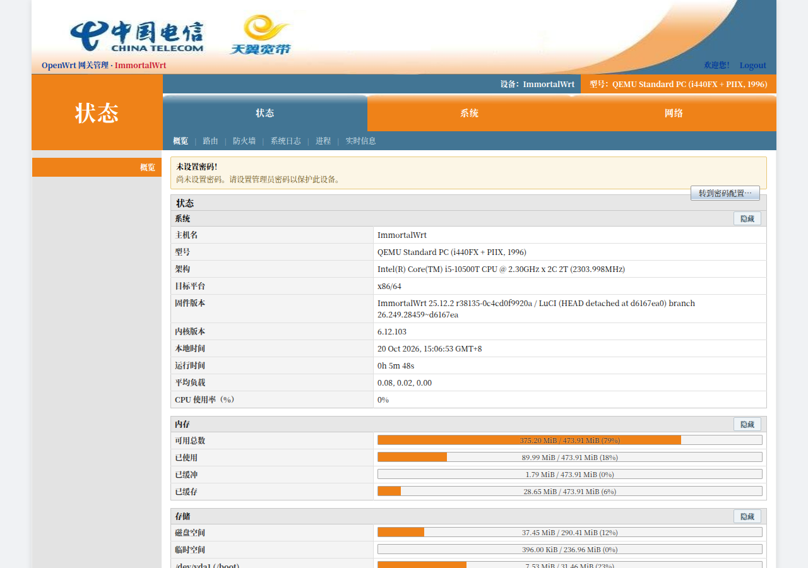
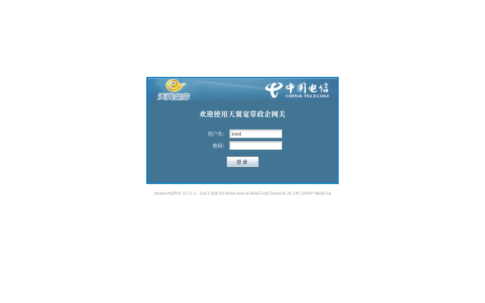
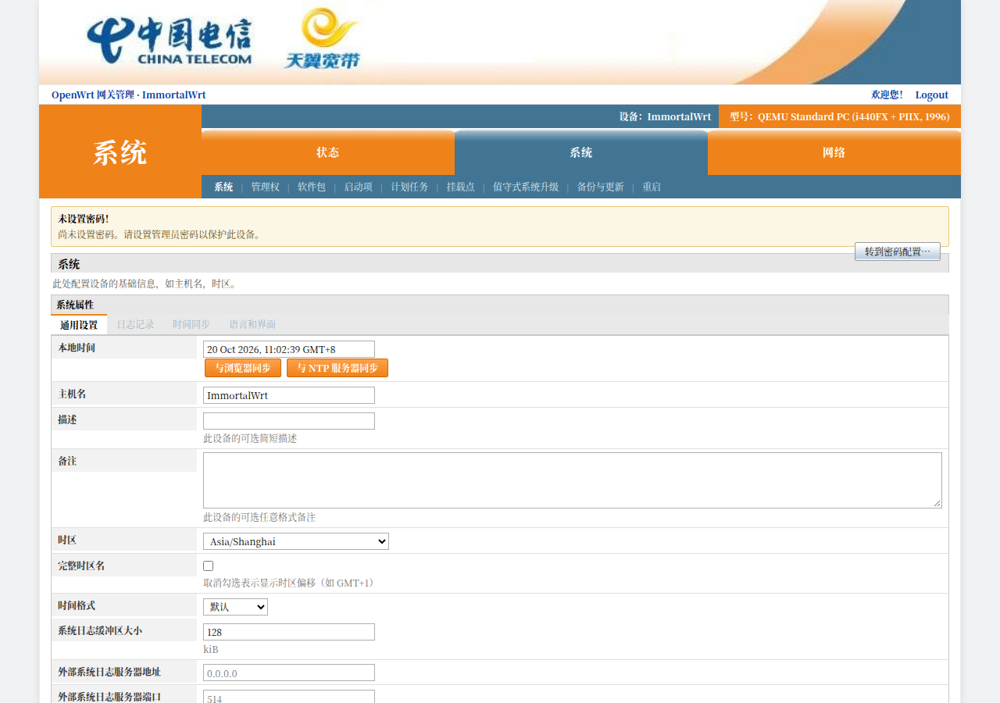
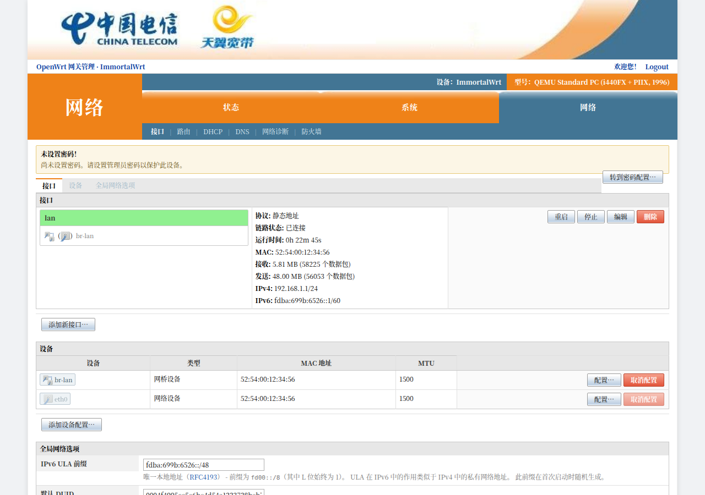
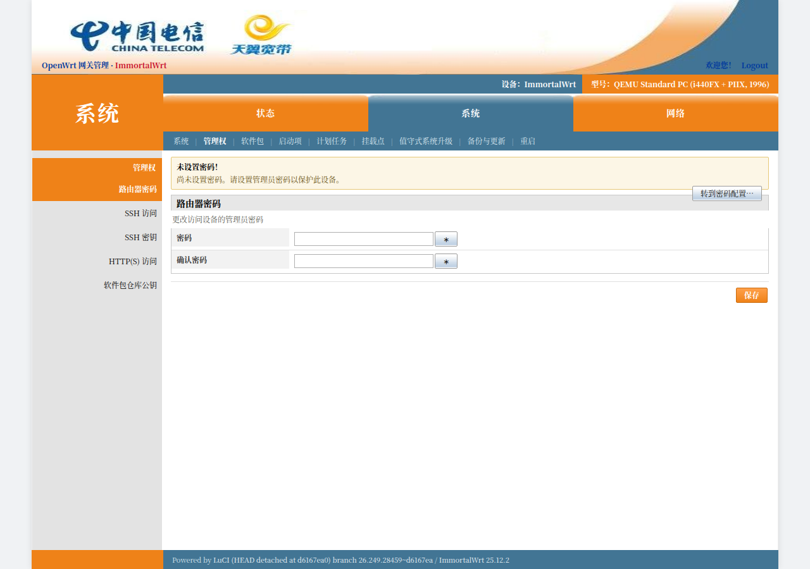
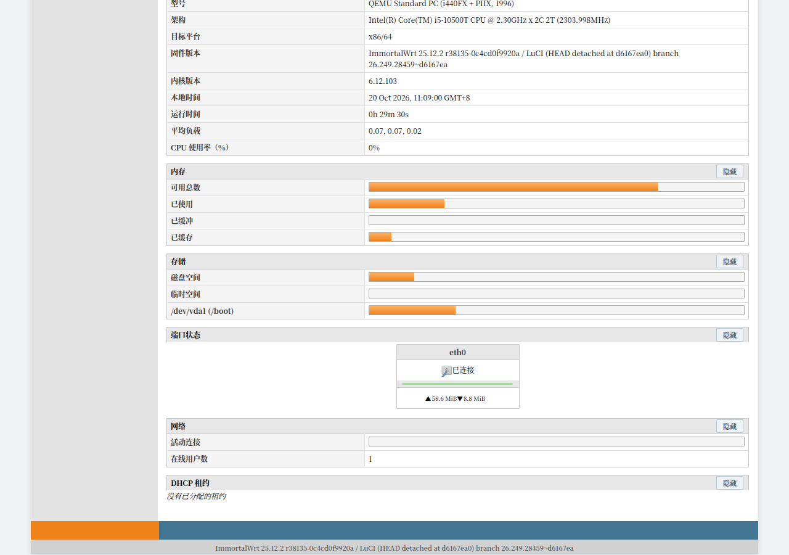
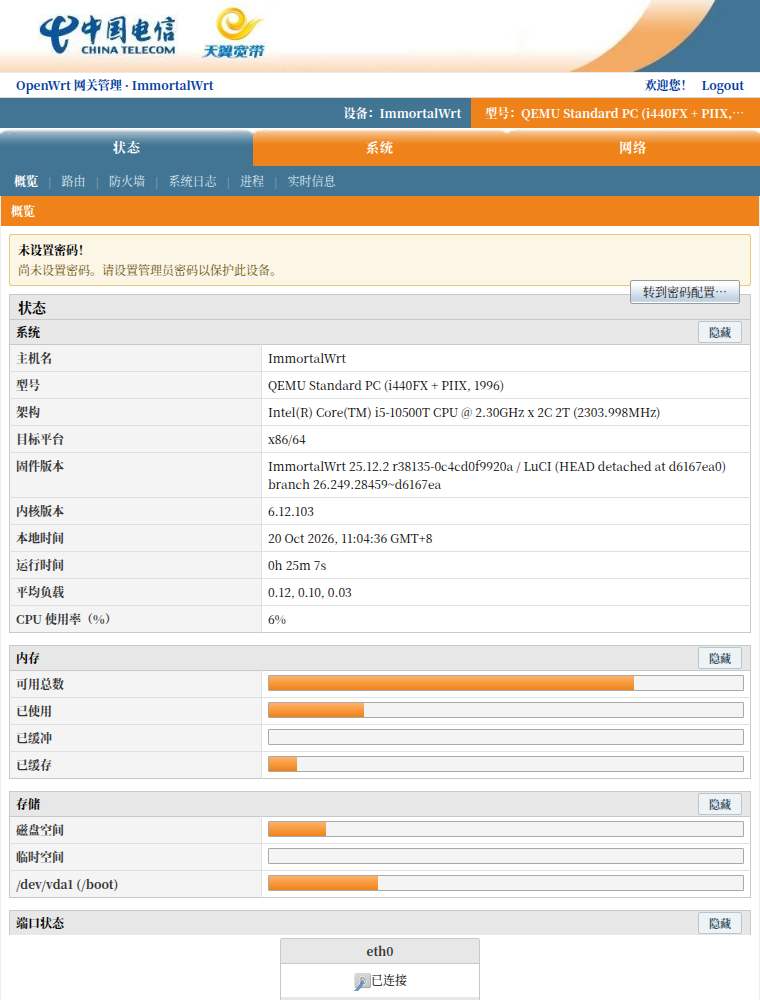

# luci-theme-ctmodem

一个照着**家庭网关（光猫 / ONT）Web 管理界面**风格重做的 OpenWrt **LuCI 主题**。

主色：橙 `#EF8218`、蓝灰 `#427594`、浅灰 `#E3E3E3`；三层导航（橙色一级菜单 / 蓝色二级菜单条 / 左侧三级导航），灰底加粗标签列表单，小号宋体、紧凑排版——尽量还原网关后台的观感，同时保持 LuCI 全部功能可用。



| 登录页 | 系统设置 |
| --- | --- |
|  |  |

| 网络设置 | 管理（修改密码） |
| --- | --- |
|  |  |

| 页脚（橙块 + 蓝条 + 版权行） |
| --- |
|  |

| 移动端 |
| --- |
|  |

## 特点

- **沿用原厂切图**：登录后头部整图 `framelogo.jpg`（白底 + 橙蓝弧 + 中国电信/天翼宽带 logo）、
  一级 Tab 顶部渐变条 `back_button.jpg` / `selected_button.jpg`、按钮底纹 `button_bg.gif`、
  登录页横幅 `diagnosed_logo.gif`、登录输入框 `login_inupt.gif` 都直接沿用设备原始素材。
- **纯 CSS + 少量原生 JS**，不依赖 Bootstrap 资源，体积小（cascade.css ≈ 45 KB + 约 75 KB 图片）。
- **三层导航**：`menu-ctmodem.js` 把 LuCI 菜单树拆成一级（橙条）/ 二级（蓝条）/ 三级（左栏）三处渲染，并自动高亮当前项、隐藏 `Logout` 这类元菜单。
- **左侧灰栏常驻**（与参考界面一致）：顶部橙色条显示当前二级栏目名，没有三级菜单时就是一块空灰栏；
  页脚同样还原「左侧 208px 橙块 + 蓝色条」。
- **页面内标签页归入左栏**：LuCI 视图里的 `cbi-tabmenu`（如「网络 → 接口 / 设备 / 全局网络选项」）
  会在视觉上移到左侧栏，用 CSS 绝对定位实现、DOM 不移动，cbi 自己的切换逻辑照常工作；
  同时补齐了 LuCI 的 `[data-tab-title]` / `[data-tab-active]` 面板显隐规则。
- 完整覆盖 LuCI 常用组件：`cbi-*` 表单、表格、按钮、标签页、模态框、下拉、动态列表、进度条、接口卡片、提示条等。
- 响应式：≤900px 时收起左栏、菜单折行，手机上也能用。
- 兼容 LuCI 24.10 / 25.x 的 **ucode 模板**体系（不提供 Lua 模板）。

## 目录

```
luci-theme-ctmodem/
├── Makefile                          # 放进 OpenWrt 源码 feeds/luci/themes/ 即可编译
├── htdocs/luci-static/ctmodem/
│   ├── cascade.css                   # 全部样式
│   ├── menu-ctmodem.js                   # 三层导航渲染
│   ├── logo.svg                      # 站点图标（favicon）
│   └── img/                          # 原厂切图资源
├── ucode/template/themes/ctmodem/
│   ├── header.ut                     # 页面骨架（品牌区 / 用户条 / 导航 / 左栏）
│   ├── footer.ut                     # 页脚（橙蓝条 + 版本信息）
│   └── sysauth.ut                    # 登录卡片
└── root/etc/uci-defaults/30_luci-theme-ctmodem   # 首次安装切换默认主题
```

## 安装到路由器

### 方式一：一键包（推荐）

```bash
./build-theme-pkg.sh          # 生成 testbed/vm/theme.tar.gz
# 传到路由器
scp testbed/vm/theme.tar.gz root@192.168.1.1:/tmp/
# 路由器上
mkdir -p /tmp/th && tar -xzf /tmp/theme.tar.gz -C /tmp/th && sh /tmp/th/install.sh
```

`install.sh` 会把文件复制到 `/www/luci-static/ctmodem` 与
`/usr/share/ucode/luci/template/themes/ctmodem`，设置
`luci.main.mediaurlbase=/luci-static/ctmodem` 并重启 uhttpd。

### 方式二：编译进固件

把 `luci-theme-ctmodem/` 放进 LuCI 源码树的 `themes/` 下（或 feeds），
`make menuconfig` → LuCI → Themes → `luci-theme-ctmodem`，随固件一起打包。

### 手工切换 / 回退

```bash
uci set luci.main.mediaurlbase='/luci-static/ctmodem'   # 或 /luci-static/bootstrap
uci commit luci && /etc/init.d/uhttpd restart
```

## 本地测试床（QEMU 模拟真机）

跑的是官方 ImmortalWrt 25.12.2 x86/64 镜像（从 `http://192.168.49.7` 拉的
`immortalwrt-25.12.2-x86-64-generic-ext4-combined.img.gz`）：

```bash
cd testbed
./run-vm.sh start        # 启动，访问 http://127.0.0.1:8088/
./run-vm.sh status
./run-vm.sh stop

# 串口（root 无密码），用于在 VM 内执行命令
python3 seriald.py &                                   # 常驻，日志写 vm/console.log
echo 'ls /www' | python3 -c "import socket,sys;s=socket.create_connection(('127.0.0.1',8099));s.sendall(sys.stdin.read().encode()+b'\n')"
```

网络拓扑：QEMU user-mode，`net=192.168.1.0/24`，宿主为 `192.168.1.254`，
`hostfwd 127.0.0.1:8088 → 192.168.1.1:80`。VM 内可直接
`wget http://192.168.1.254:8000/theme.tar.gz`（宿主 `python3 -m http.server 8000 --directory testbed/vm`）。

调试截图脚本（在 `ref/`）：`./shot-luci.sh /admin/status/overview out.png`，
会自动登录（root/空密码）、关闭首次弹窗并按目标路径截图。

## 已知限制

- 只做了 ucode 模板（LuCI 24.10+）；老的 Lua 模板（22.03 及更早）不适用。
- 一级菜单项数量由 LuCI 菜单树决定，通常只有「状态 / 系统 / 网络」三项，
  不会像参考设备那样有 7 个大项。
- 没有内置深色模式。

## 已知问题

**OpenClash 等重度自定义插件页面**：这类插件大量依赖内联样式与自有 JS，并直接把 tab 插进
LuCI 保留的 `#tabmenu`，在非 Bootstrap 主题下会出现顶部 tab 缺失、局部布局错位。
主题已对这类页面做了兜底（`ont-plain`：撤销卡片/表单/按钮/表格的主题装饰、不搬移 tab），
但无法完整复现官方渲染。

需要完整使用这类插件时，可临时切回 Bootstrap 主题：

```sh
uci set luci.main.mediaurlbase='/luci-static/bootstrap'
uci commit luci
/etc/init.d/uhttpd restart
# 用完切回：
uci set luci.main.mediaurlbase='/luci-static/ctmodem' && uci commit luci && /etc/init.d/uhttpd restart
```

## 素材来源

`img/` 下的图片取自家庭网关设备的网页静态资源，仅用于还原该类设备的界面外观；
相关商标与美术资源版权归各自权利人所有，不要单独分发这些图片；它们**不在 MIT 许可范围内**。

## 许可

MIT License，见 [LICENSE](LICENSE)。
